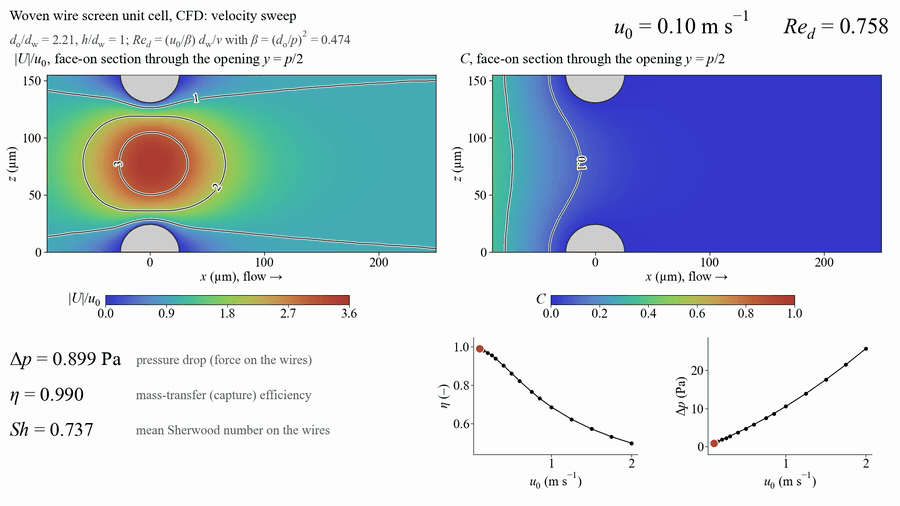
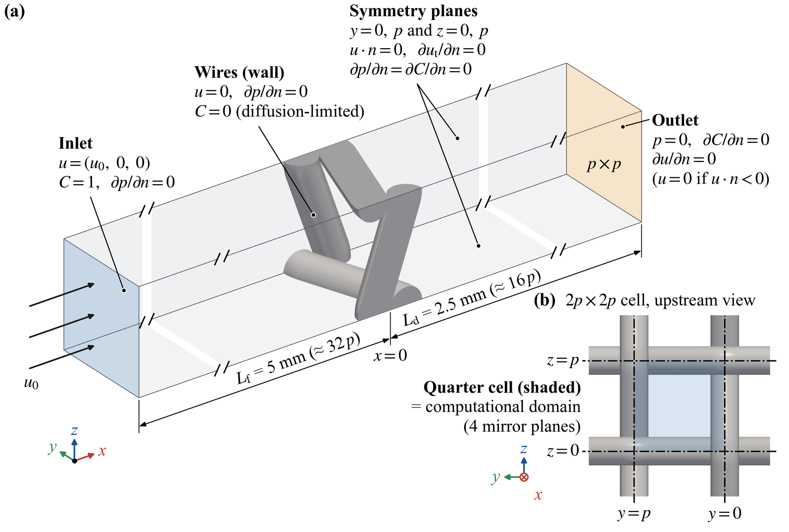
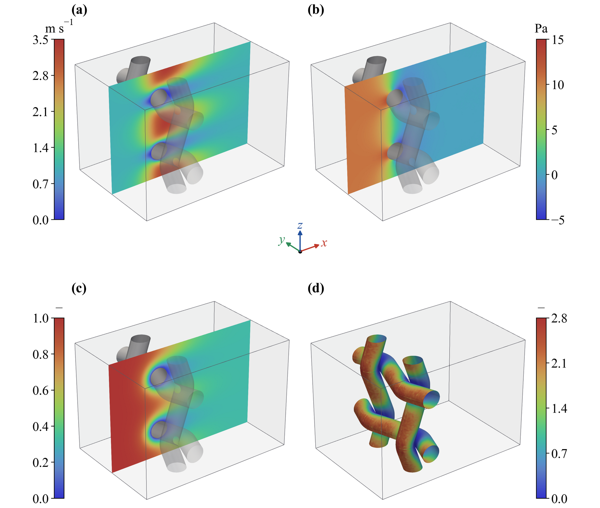
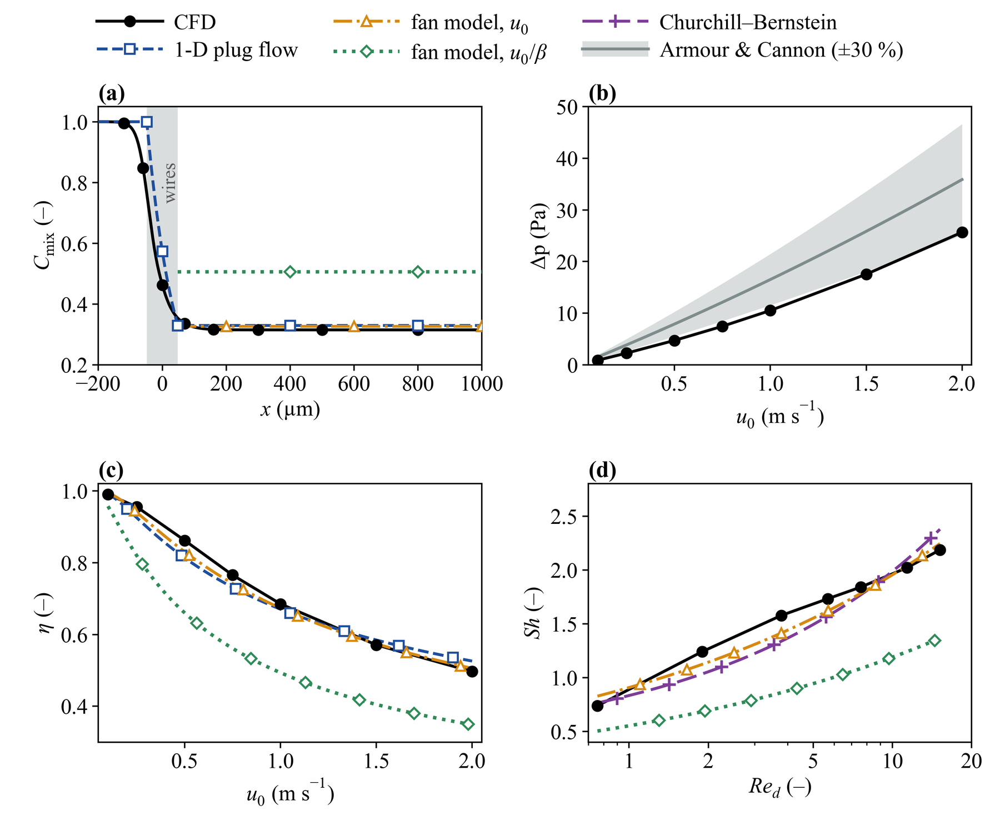
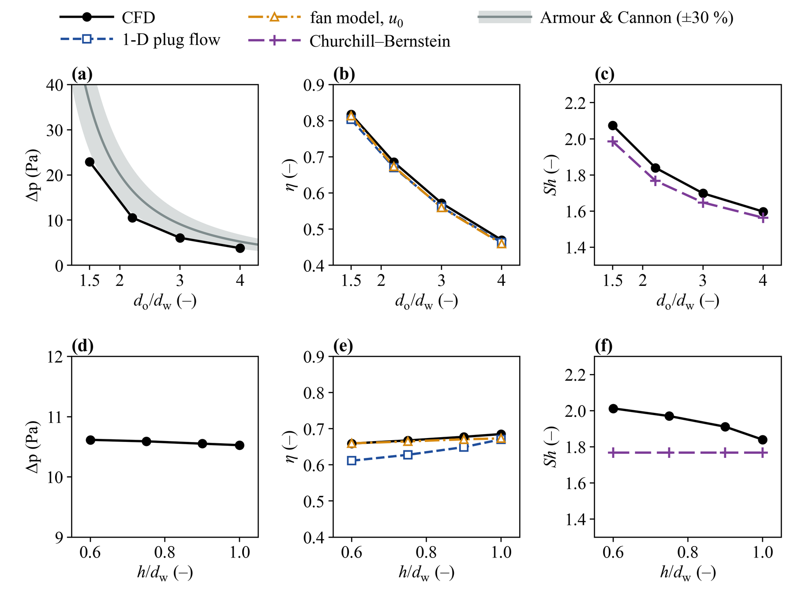

# Flow and surface reaction on a woven wire screen

*Resolved 3-D CFD of gas flow through a fine plain-square woven screen with a fast surface reaction on the wires, compared with the correlations engineers use to size screens.*

Fine woven screens serve as filters, catalyst gauzes and flow straighteners. Their pressure drop and how much of a
reacting species they remove are normally taken from correlations fitted to coarser screens. This study resolves the
flow around the individual wires of a 48 µm screen, from creeping flow to Re_d of about 15, and checks those
correlations against it. The problem was posed by Asst. Prof. Dr. Necip Berker Üner (METU Chemical Engineering).

## Introduction

<p align="center">
  
  <br><em>Approach velocity from 0.1 to 2.0 m/s: velocity magnitude (left) and reactant concentration (right) on a section through the opening, with the pressure drop, removal efficiency and Sherwood number of each case. Every key frame is a converged solution (15 speeds), and the cross-fades between them are image blends only. <a href="media/woven-velocity-sweep.mp4">MP4, 1920 × 1080</a></em>
</p>

Gas approaches the screen at a uniform velocity u0 and carries a dilute reactant. The reaction on the wires is fast
enough to consume the reactant on contact, so the removal is limited by how fast the reactant diffuses to the wire
surface. Two numbers matter to a designer: the pressure drop and the removal efficiency eta, the fraction of the
incoming reactant the screen takes out.

<p align="center">
  
  <br><em>Computational domain: a quarter of the weave's unit cell, bounded by four mirror planes through the wire axes, 5 mm upstream and 2.5 mm downstream of the screen.</em>
</p>

## What I did

- **Geometry.** A parametric CAD model of the plain-square weave following Peirce's crimp construction (wire diameter
  48.26 µm, opening 106.68 µm, open area 0.474), with a generalised construction for screens flattened by calendering.
- **Steady 3-D CFD in OpenFOAM** (simpleFoam, SIMPLEC, laminar) with the reactant solved as a passive scalar,
  on polyhedral meshes made from Gmsh tetrahedra with polyDualMesh.
- **Mesh independence** on eight levels from 34 thousand to 1.37 million cells.
- **Three parameter sweeps:** approach velocity (0.1 to 2.0 m/s), opening-to-wire ratio (1.5 to 4.0) and crimp
  height (touching wires down to 0.60 of the wire diameter).
- **Reduced models** compared with the CFD: the Armour–Cannon pressure-drop correlation, a filtration-type
  "fan" model and a 1-D plug-flow model with the Churchill–Bernstein cylinder correlation.
- **Automated pipeline** in Python: case generation from one settings record, runs with a divergence watchdog and
  a live residual monitor, automatic checks of convergence and of the species balance, and a quality score per run.
  47 converged runs in total. The animation above uses 15 of them.
- **AI-agent workflow.** I planned the study and made the decisions. A team of Claude agents (Opus, Sonnet, Haiku
  and Fable models) built the CAD, pipeline, figures and report drafts, with independent agent reviews at the
  decision points.

<details>
<summary>Model equations</summary>

```
Flow:        div(u) = 0,   (u . grad) u = -grad(p)/rho + nu*lap(u)
Reactant:    u . grad(C) = D*lap(C),   C = 1 at the inlet,   C = 0 on the wires
Efficiency:  eta = 1 - C_out/C_in
Transfer:    k = -(u0*A/S_w)*ln(1 - eta),   Sh = k*d_w/D
```

C is the reactant concentration scaled by its inlet value, A the frontal area and S_w the wetted wire area of the
cell. The reactant has Sc = 0.90 in argon at 1 atm and 293.15 K.

</details>

## Results

<p align="center">
  
  <br><em>Baseline at 1 m/s: (a) velocity, (b) pressure and (c) concentration on the plane through the opening, (d) local Sherwood number on the wires.</em>
</p>

**The bypass through the opening limits the removal.** The gas forms a jet through the opening that peaks at
3.4 u0. An unreacted core passes through the centre of the opening and mixes out downstream, so at 1 m/s the
screen removes 68.5 % of the reactant even though the wire surfaces themselves are fully reactive.

<p align="center">
  
  <br><em>Velocity sweep: (a) mixing-cup concentration through the screen, (b) pressure drop against the Armour–Cannon correlation, (c) removal efficiency against the reduced models, (d) Sherwood number.</em>
</p>

| u0 (m/s) | 0.1 | 0.25 | 0.5 | 1.0 | 2.0 |
|---|---|---|---|---|---|
| Pressure drop (Pa) | 0.90 | 2.28 | 4.73 | 10.53 | 25.66 |
| Below Armour–Cannon | 41 % | 41 % | 40 % | 36 % | 28 % |
| Removal efficiency | 0.990 | 0.956 | 0.862 | 0.685 | 0.497 |

**The standard pressure-drop correlation overpredicts.** The CFD pressure drop lies 28 % to 41 % below
Armour–Cannon, so the correlation gives 1.4 to 1.7 times the CFD value. In its own
variables the viscous coefficient of the CFD is about 5.1 instead of 8.61, while the inertial term grows faster than
the correlation assumes.

**The removal is easier to predict.** The 1-D plug-flow model and the fan model based on the approach velocity both
follow the CFD efficiency within about 6 %.

<p align="center">
  
  <br><em>Geometry sweeps at 1 m/s: opening-to-wire ratio (top) and crimp height (bottom), CFD against the reduced models.</em>
</p>

**Opening the screen** from an opening-to-wire ratio of 1.5 to 4.0 cuts the pressure drop from 22.9 to 3.8 Pa and
the removal efficiency from 0.817 to 0.470. **Flattening the screen** to a crimp height of 0.60 wire diameters costs
only 0.8 % more pressure drop but removes 15 % of the wetted wire area. The efficiency falls by 3.8 %, so the
remaining surface transfers 9.4 % more per unit area.

## Conclusions

- For fine screens at Re_d of about 1 to 15, expect the actual pressure drop to lie roughly 30 % to 40 % below the Armour–Cannon correlation.
- The removal efficiency can be estimated within a few per cent with a 1-D plug-flow model or a fan model on the approach velocity.
- The reactant that passes through the centre of the opening, not the transfer to the wires, limits the removal.
- Flattening a screen barely changes its pressure drop but reduces its active surface.

## Limits

- **Placeholder diffusivity.** Sc = 0.90 stands in for the actual reacting species.
- **One screen.** Stacks of screens and the interaction between them are not modelled.
- **Sweep resolution.** The sweeps use a coarse mesh that underestimates the pressure drop by about 2.4 % at the
  baseline. The efficiency changes by less than 0.1 % between mesh levels.
- **Idealised flattening.** Flattened wires are represented by interpenetrating circular wires, which do not conserve
  the wire volume.
- **No experiment yet.** The results are compared with correlations, not with measurements on this screen.

## Source and copyright

This repository holds only this page, its figures and the animation. The CAD scripts, OpenFOAM cases, meshes,
pipeline code and report are private.

Copyright (c) 2026 Ahmet Berkay Şimşek. All rights reserved. The figures and the animation may not be reused
without permission.
